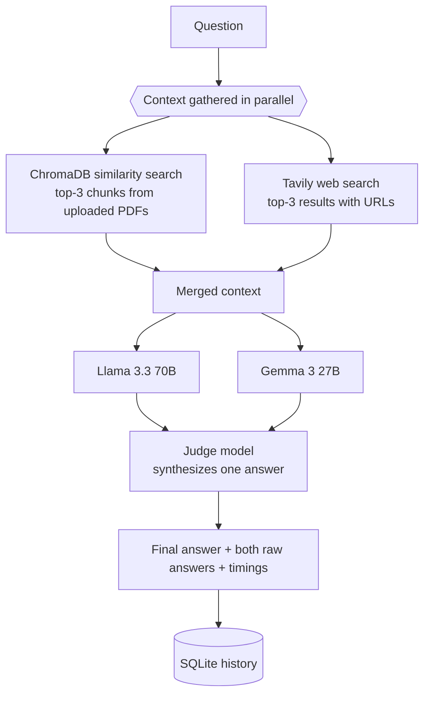

# AI Fusion Chat — MVP

> Ask one question, get answers from **two LLMs in parallel**, and let a **third model act as a judge** that merges them into one final answer. Answers are grounded in your **PDFs** (RAG over ChromaDB) and **live web search** (Tavily).


---

## How a request flows



- **Parallel everything.** PDF retrieval and web search run concurrently (`asyncio.to_thread`), then both models are queried concurrently with `asyncio.gather` — the user waits for the slowest model, not for the sum.
- **LLM-as-a-Judge.** A third model receives the question and both answers and writes a single final answer without meta-commentary. If both answers start identically, the judge call is skipped to save time and tokens.
- **Grounding rules in the prompt.** Personal-file questions are answered only from PDF data; unrelated PDF and web content must not be mixed; the current date is injected so web results are read in context.
- **RAG.** Uploaded PDFs are split into 500-character chunks (50 overlap), embedded locally with `sentence-transformers/all-MiniLM-L6-v2` and stored in a persistent ChromaDB collection — no paid embedding API.
- **Observability-lite.** Every model answer and its latency is stored in SQLite; `/stats` shows request count and avg / min / max latency per model.

## Quick start

```bash
python3 -m venv venv && source venv/bin/activate
pip install -r requirements.txt

cat > .env <<EOF
OPENROUTER_API_KEY=sk-or-...
TAVILY_API_KEY=tvly-...
EOF

cd backend && uvicorn server:app --reload      # terminal 1 → http://localhost:8000/docs
streamlit run frontend/ui.py                   # terminal 2 → http://localhost:8501
```

Upload a PDF in the sidebar, then ask questions about it — or about anything current on the web.

## API

| Method | Endpoint | Description |
|---|---|---|
| `POST` | `/ask` | Two models + judge over PDF and web context |
| `POST` | `/upload` | Add a PDF to the knowledge base |
| `GET` | `/history?limit=10` | Recent requests |
| `GET` | `/stats` | Requests and avg / min / max latency per model |
| `DELETE` | `/clear` | Clear history |

<details>
<summary>Example response</summary>

```json
{
  "status": "success",
  "question": "How does a quantum computer work?",
  "model1": { "name": "meta-llama/llama-3.3-70b-instruct:free", "answer": "…", "duration": "3.20s" },
  "model2": { "name": "google/gemma-3-27b-it:free", "answer": "…", "duration": "2.80s" },
  "final_answer": "A quantum computer uses qubits…",
  "total_duration": "7.50s"
}
```
</details>

## Roadmap

This MVP proved the idea; the next version moves to a production stack:

- Model selection per request and multi-model routing through OpenRouter
- Chat sessions with history passed to the models
- Async SQLAlchemy + PostgreSQL instead of SQLite, Next.js frontend
- Retrieval that decides **whether** web search or PDF context is needed instead of always fetching both
- Langfuse tracing and an eval set for judge quality
